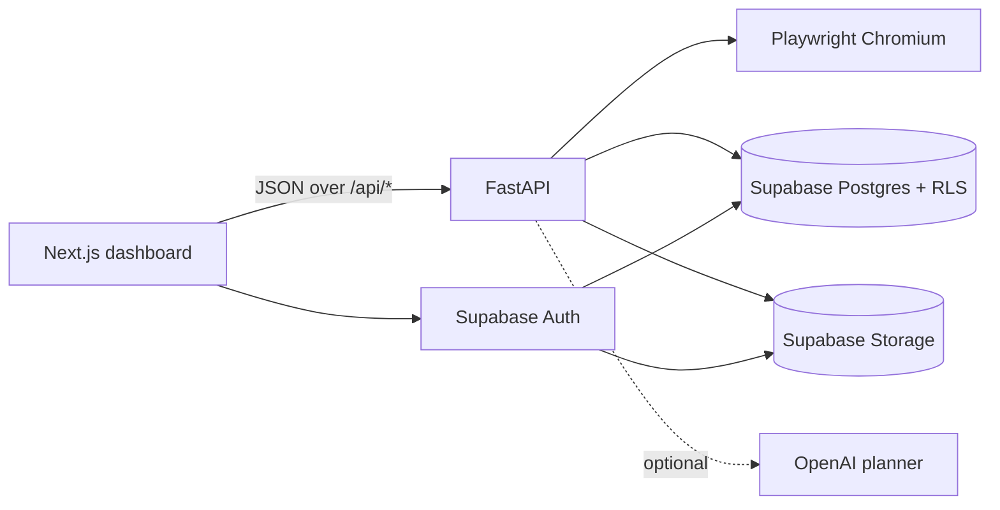

# NEXORA

NEXORA is a FastAPI + Playwright web extraction service with a Next.js dashboard.
It queues browser jobs, records status/logs/results, and optionally uses OpenAI
for planning and answers. Supabase provides authentication, PostgreSQL
persistence, Row Level Security, and a private Storage bucket for screenshots.

## What is implemented

- FastAPI API with a managed Playwright Chromium browser.
- Structured page extraction: title, description, text, headings, links,
  screenshot data, execution steps, and timings.
- Synchronous agent runs and cancellable background tasks with
  `queued → running → succeeded/failed/cancelled` states.
- Task status, progress, logs, and result endpoints.
- Public-URL validation that blocks private, loopback, link-local, reserved, and
  cloud metadata targets (SSRF protection).
- In-process sliding-window rate limiting for agent and task endpoints.
- Optional OpenAI planning and answer generation. Without `OPENAI_API_KEY`,
  `answer` is `null` and `plan` is `[]`.
- Supabase access-token verification. JWTs are verified with the configured JWT
  secret (HS256) or against the project JWKS using the asymmetric algorithm
  derived from the signing key.
- Supabase-backed profiles, runs, task snapshots, logs, and results, protected
  by RLS policies keyed to `auth.uid()`.
- Private `generated-files` Storage bucket. The dashboard exposes a manual
  "Save screenshot to Storage" action on successful task results.
- Next.js + Tailwind dashboard with Overview, New Run, Tasks, Task Detail,
  Saved Results, Settings, and Profile pages.
- CSV/JSON exports for current results, execution traces, links, and saved runs.
- Backend tests, frontend unit tests, and a production frontend build.

## Architecture



The browser never receives privileged Supabase credentials. Backend writes use
the service role key; client reads are scoped by RLS to `auth.uid()`.

## Repository layout

```text
backend/app
├── main.py            FastAPI app, lifespan, /health, /v1/models
├── browser.py         Playwright lifecycle (dedicated Proactor loop on Windows)
├── agent.py           /v1/agent/run, /v1/agent/capabilities, execute_run
├── tasks.py           /v1/tasks workflow, cancellation, logs, results
├── security.py        Public URL / SSRF validation
├── ratelimit.py       In-memory sliding-window limiter
├── auth.py            Supabase access-token verification
├── supabase_store.py  Server-side Supabase REST/Storage writes
├── planner.py         Optional OpenAI plan + answer
├── config.py          Environment configuration
└── schemas.py         Request/response models

backend/tests          pytest suite, including JWKS security tests
frontend/app           Next.js App Router dashboard pages
frontend/components    Auth provider, app shell, status, result, export UI
frontend/lib           API client, Supabase services, export helpers
supabase/schema.sql    Tables, RLS policies, profile trigger, Storage bucket
.env.example           Backend environment template
```

## Local setup

```powershell
python -m venv .venv
.\.venv\Scripts\Activate.ps1
python -m pip install -r requirements.txt
python -m playwright install chromium
cd frontend
npm install
```

Run the backend on port 8000:

```powershell
python -m uvicorn app.main:app --app-dir backend --reload
```

Run the frontend on port 3000 in a second terminal:

```powershell
cd frontend
npm run dev
```

Open `http://localhost:3000`. The Next.js dev server proxies `/api/*` to the
backend, so local CORS setup is not needed.

With no keys configured, the app runs in deterministic local mode: browsing,
extraction, screenshots, traces, tasks, cancellation, and exports still work.
OpenAI and Supabase persistence are optional.

## Dashboard pages

| Route | Purpose |
|---|---|
| `/` | Overview metrics, system status, recent tasks |
| `/runs/new` | Queue a browser task |
| `/runs` | Live task list with progress and cancellation |
| `/runs/[id]` | Task status, execution log, result, exports, screenshot upload |
| `/history` | Supabase-backed saved runs with CSV/JSON export |
| `/settings` | Supabase sign in/sign up and runtime configuration |
| `/profile` | Supabase profile and display name |

## Configuration

Copy `.env.example` to root `.env` for backend settings. Keep the real file out
of source control. Node 20+ is recommended for the frontend.

### Environment variables

Backend, in root `.env`:

| Variable | Purpose | Default |
|---|---|---|
| `OPENAI_API_KEY` | Enables planning and answers | unset |
| `OPENAI_MODEL` | Model used by the planner | `gpt-4o-mini` |
| `OPENAI_TIMEOUT_S` | Planner request timeout | `30` |
| `MAX_AI_CONTEXT_CHARS` | Page text sent to the planner | `6000` |
| `AI_MAX_PLAN_STEPS` | Maximum plan steps returned | `8` |
| `SUPABASE_URL` | Project URL | unset |
| `SUPABASE_ANON_KEY` | Public anon key | unset |
| `SUPABASE_SERVICE_ROLE_KEY` | Backend-only write key | unset |
| `SUPABASE_JWT_SECRET` | Legacy HS256 verification secret | unset |
| `SUPABASE_JWKS_URL` | Preferred JWKS verification endpoint | unset |
| `SUPABASE_STORAGE_BUCKET` | Private screenshot bucket | `generated-files` |
| `DATABASE_CONFIGURED` | Enables Supabase writes after schema setup | `false` |
| `RATE_LIMIT_PER_MINUTE` | Sliding-window limit | `30` |
| `RATE_LIMIT_WINDOW_SECONDS` | Sliding-window size | `60` |

Frontend, in `frontend/.env.local`:

| Variable | Purpose | Default |
|---|---|---|
| `NEXT_PUBLIC_SUPABASE_URL` | Public project URL | unset |
| `NEXT_PUBLIC_SUPABASE_ANON_KEY` | Public anon key | unset |
| `NEXT_PUBLIC_SUPABASE_STORAGE_BUCKET` | Screenshot bucket name | `generated-files` |
| `NEXORA_API_URL` | Backend target for `/api/*` rewrites | `http://127.0.0.1:8000` |

Only `NEXT_PUBLIC_*` values are available to browser code. `NEXORA_API_URL` is
used by the Next.js rewrites, not exposed as a browser secret.

### Optional OpenAI

```text
OPENAI_API_KEY=sk-...
```

Restart the backend after changing it.

### Optional Supabase

The schema is compatible with the Supabase Free Plan.

1. Create a Supabase project and run `supabase/schema.sql` in the SQL Editor.
2. Enable **Authentication → Sign In / Providers → Email**.
3. Copy the project URL and the public anon key from **Project Settings → API**.
4. Fill root `.env` with backend values. Use either `SUPABASE_JWT_SECRET` or
   `SUPABASE_JWKS_URL`; leave the unused one blank. Newer projects expose JWKS.

```text
SUPABASE_URL=https://your-project.supabase.co
SUPABASE_ANON_KEY=your-anon-key
SUPABASE_SERVICE_ROLE_KEY=your-service-role-key
SUPABASE_JWT_SECRET=
SUPABASE_JWKS_URL=https://your-project.supabase.co/auth/v1/.well-known/jwks.json
SUPABASE_STORAGE_BUCKET=generated-files
DATABASE_CONFIGURED=true
```

5. Fill `frontend/.env.local` with public browser values only:

```text
NEXT_PUBLIC_SUPABASE_URL=https://your-project.supabase.co
NEXT_PUBLIC_SUPABASE_ANON_KEY=your-anon-key
NEXT_PUBLIC_SUPABASE_STORAGE_BUCKET=generated-files
```

6. Restart both servers.

`SUPABASE_SERVICE_ROLE_KEY`, `SUPABASE_JWT_SECRET`, and other privileged values
must stay backend-only. The browser uses only the anon key and public project
URL. `DATABASE_CONFIGURED` should be `true` only after the schema and Storage
bucket exist in the target project.

## API

| Method | Path | Purpose |
|---|---|---|
| GET | `/health` | Liveness |
| GET | `/v1/models` | OpenAI-compatible model list |
| GET | `/v1/agent/capabilities` | Browser, AI, auth, and limit metadata |
| POST | `/v1/agent/run` | Synchronous navigate, extract, plan/answer |
| POST | `/v1/tasks` | Queue a task |
| GET | `/v1/tasks` | List tasks |
| GET | `/v1/tasks/{id}` | Task status and full record |
| GET | `/v1/tasks/{id}/logs` | Task execution logs |
| GET | `/v1/tasks/{id}/result` | Task result once succeeded |
| DELETE | `/v1/tasks/{id}` | Cancel a queued/running task |

Errors: `401` missing/invalid Supabase token when auth is on, `409` result not
ready, `422` invalid or unsafe input, `429` rate limited, `502` browser failure,
`503` browser unavailable, `504` timeout.

## Tests

```powershell
.\.venv\Scripts\Activate.ps1
python -m pytest backend/tests -q
cd frontend
npm test
npm run build
```

The backend suite uses local test tokens with authentication enabled; it does
not require Supabase credentials and does not write to Supabase.

## Resource limits

One shared Chromium process is reused across requests. At most four browser
page contexts run concurrently; extra tasks wait for a free slot. In-memory
task history is capped at 200 records, and the default rate limit is 30
requests per minute per user.

Full-page PNGs larger than 5 MB are recorded as skipped instead of being
base64-encoded into a result. URL syntax is checked at the Pydantic boundary,
DNS resolution runs in a worker thread, and document navigations including
redirects are revalidated before Playwright sends them.

For local development, run one backend and one frontend process. Chromium is
the largest memory consumer, so avoid duplicate `uvicorn` or `next dev`
instances. Task polling stops once a task reaches a terminal state.

## Deployment

`Dockerfile` builds the backend image. The frontend can be deployed to Vercel or
any Node host. Set `NEXORA_API_URL` to the public backend URL so `/api/*` rewrites
point at it. Configure public `NEXT_PUBLIC_SUPABASE_*` variables in the frontend
host and keep all privileged Supabase variables backend-only. Run
`supabase/schema.sql` in the target project before accepting live users.

There are no Firebase or Firestore dependencies in the active architecture.
